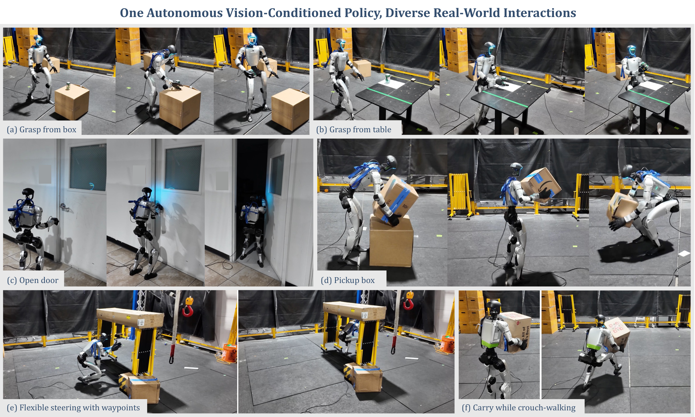
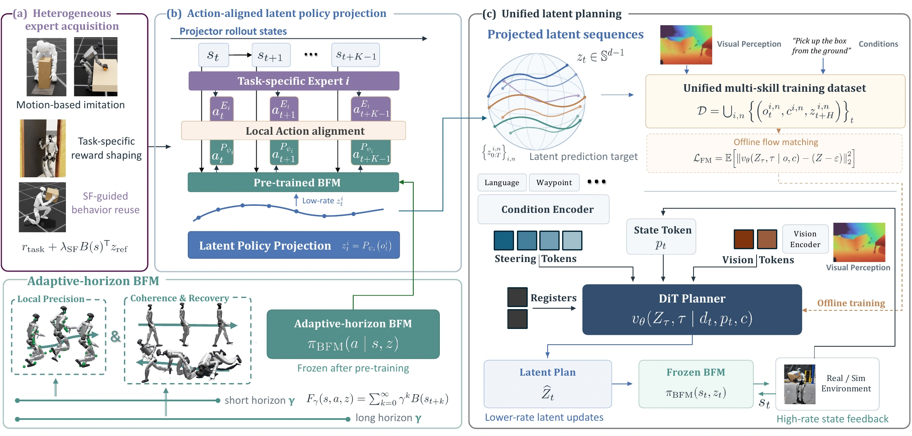
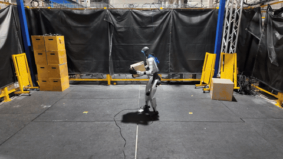

[](https://fiberaa.github.io/)

[](https://arxiv.org/abs/2610.24675)
[](resources/FIBER.pdf)
[](https://fiberaa.github.io/)
[](https://fiberaa.github.io/#interactive)
[](https://fiberaa.github.io/static/videos/FIBER_demo.mp4)

# FIBER: Action-Aligned Latent Planning for Versatile Humanoid Loco-Manipulation

[Yutang Lin](https://yutang-lin.github.io/),
[Guanya Shi](https://www.gshi.me/),
[C. Karen Liu](https://cs.stanford.edu/~karenliu/)

Amazon Frontier AI & Robotics · Carnegie Mellon University · Stanford University

## Abstract

Learning a single perceptive policy for diverse humanoid loco-manipulation requires unifying high-level task decisions without losing the state-dependent physical responses that make each interaction succeed. This makes the representation between high-level planning and whole-body control critical: kinematic or contact targets provide compact abstractions but do not directly encode interaction-specific control responses, while directly predicting low-level actions requires the planner to model high-frequency closed-loop feedback. We propose FIBER, a framework that uses the executable latent space of a frozen Behavior Foundation Model (BFM) as a shared planning representation for heterogeneous interaction skills. Our Latent Policy Projection (LPP) maps independently acquired task-specific policies into this representation by identifying latent commands whose induced actions match their local control responses, enabling lower-rate planning while retaining the BFM's high-frequency state feedback. After projection, we aggregate closed-loop latent rollouts from all skills and train a single perceptive flow planner entirely offline. We further introduce AH-BFM, an adaptive-horizon BFM trained with multi-γ Forward-Backward (FB) learning to support both precise control and temporally extended whole-body behavior. We evaluate FIBER on box pickup, door opening, and object grasping in simulation and on a real Unitree G1 humanoid. Across 128 diverse variations per task in simulation, FIBER achieves 42.0% mean success, more than tripling projected latent replay (11.6%) and substantially outperforming kinematic planning (3.5%). Real-world experiments further demonstrate sim-to-real transfer, skill chaining, and conditional steering through the same unified planner.

## Overview

FIBER uses the action-aligned latent space of a frozen behavioral foundation model as the interface between perceptive planning and whole-body control:

1. Acquire task-specific experts independently.
2. Project each expert into executable latents through action alignment.
3. Train one perceptive latent planner offline on the projected rollouts.
4. Deploy with lower-rate planning and high-frequency feedback from the frozen BFM.



## Demos

[](https://fiberaa.github.io/)

Watch the [overview video](https://fiberaa.github.io/static/videos/FIBER_demo.mp4), explore the [real-world and simulation results](https://fiberaa.github.io/), or try the [interactive MuJoCo playground](https://fiberaa.github.io/#interactive).

## Code

**Code coming soon.** This repository currently contains the paper's teaser, visual overview, links, and citation.

## Citation

```bibtex
@misc{lin2026fiber,
  title  = {Action-Aligned Latent Planning for Versatile Humanoid Loco-Manipulation},
  author = {Lin, Yutang and Shi, Guanya and Liu, C. Karen},
  year   = {2026},
  eprint = {2610.24675},
  archivePrefix = {arXiv},
  primaryClass = {cs.RO},
  url = {https://arxiv.org/abs/2610.24675}
}
```

The citation is also available in [CITATION.bib](CITATION.bib).

## License

See [LICENSE](LICENSE) for the Apache License 2.0.
